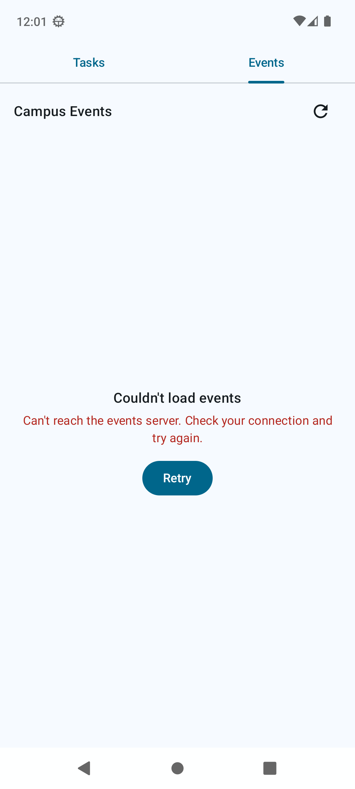
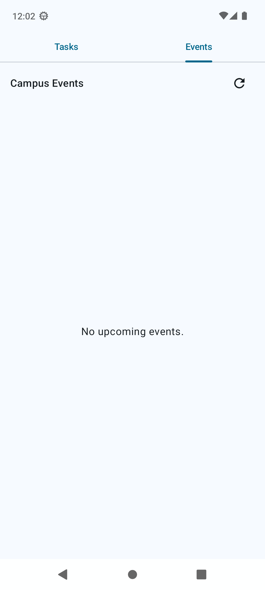
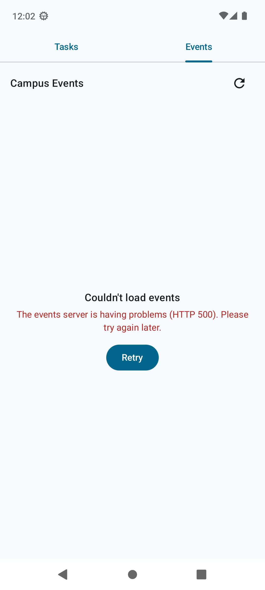
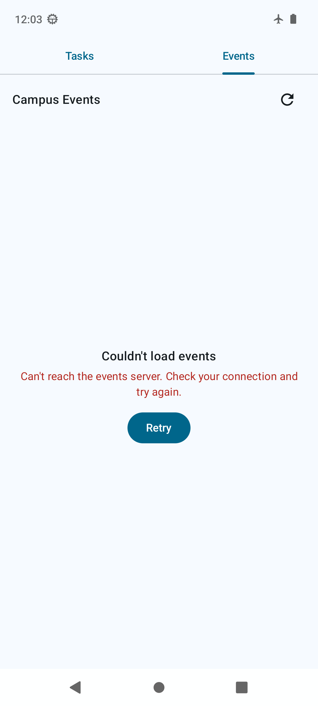
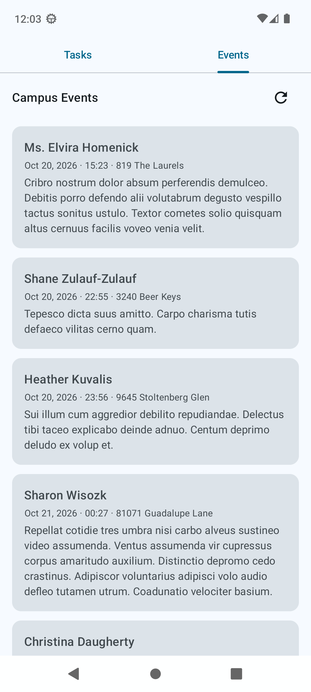

# Campus Events – Real API Integration and Failure Exercise

**Author:** Hadi Joe Bassil

**Date:** 2026-10-27

**Device:** Android emulator `ex1` ("Android SDK built for x86_64"), Android 13 (API 33), 1080x2400. Cold-booted with `-dns-server 8.8.8.8`.

**App:** `com.inci.campuscompanion`, debug build

GitHub PR link: https://github.com/toufic-fy/Campus-Companion/pull/3

Every result below was observed on the emulator through `adb`: UI hierarchy dumps (`uiautomator`), screenshots (`adb exec-out screencap -p`, each one opened and checked), and `adb logcat`.

---

## Changes after teacher review

- **API source.** The app now fetches events from the API posted on Moodle: `GET https://6ad70838f71f154ac4879fac.mockapi.io/api/v1/events/event`. Before coding, `curl` returned HTTP 200 and a JSON array of 50 objects, each with 8 string fields.
- **`CampusApi`.** `BASE_URL = "https://6ad70838f71f154ac4879fac.mockapi.io/api/v1/"` and `@GET("events/event") suspend fun getEvents(): List<EventDto>`.
- **`EventDto`.** Rewritten to mirror the JSON field for field: `id`, `createdAt`, `name`, `avatar`, `startingDate`, `endingDate`, `description`, `address`. All are `String?`. The names match the JSON exactly, so no `@SerializedName` is needed.
- **`CampusEvent.id`.** Changed from `Int` to `String`, because the API returns `"id": "1"`.
- **`EventDto.toDomain()`** in `EventsRepository.kt`:
    - `title` comes from `name`.
    - `location` comes from `address`, with fallback `"TBA"`.
    - `startsAt` comes from `startingDate`, formatted by `formatEventDate()`.
    - `description` is kept.
    - Items with a blank `id` or `name` are still dropped.
- **Date parsing.** minSdk is 24, and the project has no core-library desugaring, so `java.time` is not used. `formatEventDate()` parses the ISO-8601 UTC string with `SimpleDateFormat` (pattern `yyyy-MM-dd'T'HH:mm:ss.SSS'Z'`, then the same without millis), with `isLenient = false`. It formats as `MMM d, yyyy · HH:mm` in the device time zone. If parsing fails, it returns the raw string, so bad data cannot crash the list.
- **Old data source removed.** `api/events.json` was deleted from the project folder. `grep -rn "raw.githubusercontent\|events.json" app/src` finds nothing.
- **Unchanged.** HTTPS, the `INTERNET` permission, the Gson converter, Loading / Content / Empty / Error + Retry, `toUserMessage()`, the `Log.w` in the repository, and the `CancellationException` rethrow.

Real API data on screen (network on, first launch). The first item, `"startingDate":"2026-10-20T12:23:40.729Z"`, is shown as `Oct 20, 2026 · 15:23` in the emulator's UTC+3 time zone:


---

## Summary

| # | Scenario | Expected | Observed | Matched on first try | Fix needed |
|---|----------|----------|----------|----------------------|------------|
| 1 | Network off (airplane mode) | Error, no crash | Error + Retry; Retry gives Error again; same PID | Yes | No |
| 2 | Invalid base URL + Retry | Retryable Error | Error + Retry; each Retry logs a new `UnknownHostException` | Yes | No |
| 3 | Endpoint returns `[]` | Dedicated Empty message | "No upcoming events.", no Error title, no Retry button | Yes | No |
| 4 | Restore endpoint, network on, Retry | Content returns | Real API list shown after Retry | Yes | No |

Extras (temporary mock): HTTP 404, HTTP 500 and an object-instead-of-array body each mapped to Error with the correct category message. No crash.

---

## Scenario 1 – Disconnect the network

**Change:** no code change. Network turned off with `adb shell cmd connectivity airplane-mode enable`. `dumpsys connectivity` reported `Active default network: none`. The app was force-stopped, launched, and the Events tab opened. Then Retry was pressed.

**Observed:**

- On launch, the Error state: "Couldn't load events" / "Can't reach the events server. Check your connection and try again." / Retry.
- After Retry, the same Error state.
- The process ID stayed `2245` before and after Retry. No crash, and no `FATAL` line in logcat.

**Logcat:**
```
10-27 12:00:19.733  2245  2245 W EventsRepository: Failed to load events: java.net.UnknownHostException: Unable to resolve host "6ad70838f71f154ac4879fac.mockapi.io": No address associated with hostname
10-27 12:00:32.683  2245  2245 W EventsRepository: Failed to load events: java.net.UnknownHostException: Unable to resolve host "6ad70838f71f154ac4879fac.mockapi.io": No address associated with hostname
```

| Launch (offline) | After Retry (offline) |
|---|---|
|  |  |

**Matched expected behavior:** Yes. **Fix:** none needed.

---

## Scenario 2 – Invalid base URL

**Change (temporary, reverted):** in `app/src/main/java/com/inci/campuscompanion/data/remote/CampusApi.kt`, line 12:
```
- private const val BASE_URL = "https://6ad70838f71f154ac4879fac.mockapi.io/api/v1/"
+ private const val BASE_URL = "https://campus-events.invalid/api/v1/"
```
Network was on (`Active default network: 103`, and the real API host resolved from the emulator shell). The app was rebuilt, installed and launched, then Retry was pressed.

**Observed:**

- Error state with "Can't reach the events server. Check your connection and try again." and Retry, on launch and again after Retry.
- Each Retry sent a new request (one log line per attempt).
- PID `2479`, no crash.

**Logcat:**
```
10-27 12:01:07.515  2479  2479 W EventsRepository: Failed to load events: java.net.UnknownHostException: Unable to resolve host "campus-events.invalid": No address associated with hostname
10-27 12:01:20.447  2479  2479 W EventsRepository: Failed to load events: java.net.UnknownHostException: Unable to resolve host "campus-events.invalid": No address associated with hostname
```

| Launch | After Retry |
|---|---|
|  |  |

**Matched expected behavior:** Yes. **Fix:** none needed.

---

## Scenario 3 – Empty JSON array

**Change (temporary, reverted):** `CampusApi.kt` was first restored to the valid URL. Then a temporary OkHttp client was added to `Retrofit.Builder()`. Its interceptor answers every request with HTTP 200 and body `[]`, so the response still goes through Retrofit, the Gson converter, `EventsRepository` and `EventsViewModel`:
```kotlin
.client(OkHttpClient.Builder().addInterceptor { chain ->
    Response.Builder().request(chain.request()).protocol(Protocol.HTTP_1_1)
        .code(MOCK_CODE).message("mock")
        .body(ResponseBody.create(MediaType.get("application/json"), MOCK_BODY))
        .build()
}.build())
```
with `MOCK_CODE = 200` and `MOCK_BODY = "[]"`.

**Observed:**

- Only "No upcoming events." is shown. There is no "Couldn't load events" title and no Retry button, so it is clearly different from Error.
- No `EventsRepository` line in logcat, because this is the success path that leads to `EventsUiState.Empty`.
- PID `2648`, no crash.



**Matched expected behavior:** Yes. **Fix:** none needed.

### Extras – HTTP 404, HTTP 500, malformed body

Same temporary interceptor, with only `MOCK_CODE` / `MOCK_BODY` changed for each run. The interceptor was removed afterwards.

| Mock response | UI message (Error + Retry) | Logcat |
|---|---|---|
| `404` `{"error":"not found"}` | The events feed could not be found (HTTP 404). | `W EventsRepository: Failed to load events: retrofit2.HttpException: HTTP 404 mock` |
| `500` `{"error":"boom"}` | The events server is having problems (HTTP 500). Please try again later. | `W EventsRepository: Failed to load events: retrofit2.HttpException: HTTP 500 mock` |
| `200` `{"events":[]}` | The events data was in an unexpected format. | `W EventsRepository: Failed to load events: java.lang.IllegalStateException: Expected BEGIN_ARRAY but was BEGIN_OBJECT at line 1 column 2 path $` |

| HTTP 404 | HTTP 500 | Object instead of array |
|---|---|---|
|  |  |  |

---

## Scenario 4 – Restore the valid endpoint and Retry

**Change:**

- `CampusApi.kt` was restored from the backup taken before any temporary change. `cmp` reported the file byte-for-byte identical.
- `grep -rn "TEMP\|MOCK_\|\.invalid\|okhttp3" app/src` found nothing.
- The app was rebuilt and installed.

**Steps:**

1. Network off (`airplane-mode enable`), app launched. Error state shown.
2. Network on (`airplane-mode disable`). The API host resolved from the emulator about 6 s later, and `Active default network: 104` was reported.
3. Retry pressed in the same running app.

**Observed:**

- The real API list returned: "Ms. Elvira Homenick · Oct 20, 2026 · 15:23 · 819 The Laurels", "Shane Zulauf-Zulauf", "Heather Kuvalis", "Sharon Wisozk", …
- No `EventsRepository` failure line in logcat after Retry.
- PID `3102`, no crash.

| Before Retry (offline) | After Retry (online) |
|---|---|
|  |  |

**Matched expected behavior:** Yes. **Fix:** none needed.

---

## Failure classification

The mapping is done by `EventsViewModel.toUserMessage()`. The repository rethrows `CancellationException`, so it never reaches this mapping.

| Category | Exception (as observed / handled) | Message |
|---|---|---|
| No connection / bad host | `IOException`, e.g. `UnknownHostException` | Can't reach the events server. Check your connection and try again. |
| Timeout | `SocketTimeoutException` | The server took too long to respond. Please try again. |
| HTTP 4xx | `HttpException` 400–499 | The events feed could not be found (HTTP xxx). |
| HTTP 5xx | `HttpException` 500–599 | The events server is having problems (HTTP xxx). Please try again later. |
| Serialization / data mismatch | `IllegalStateException`, `JsonParseException`, `MalformedJsonException`, `EOFException` | The events data was in an unexpected format. |

A success with an empty list becomes `Empty`, not `Error`.

---

## Layers explanation – one refresh action

**Request path (down):**

- **Compose UI.** `EventsScreen(uiState, onRefresh)`
    - `MainActivity` collects `eventsViewModel.uiState` with `collectAsStateWithLifecycle()` and passes it in.
    - Tapping **Retry** (`EventsError`) or the refresh `IconButton` calls `onRefresh`, which is `eventsViewModel.refresh()`.
    - The UI only renders state. It does no loading itself.
- **ViewModel.** `EventsViewModel.refresh()`
    - Sets `_uiState.value = EventsUiState.Loading`, so the UI shows `CircularProgressIndicator`.
    - Launches a coroutine in `viewModelScope` and calls `eventsRepository.getEvents()`.
- **Repository.** `EventsRepository.getEvents(): Result<List<CampusEvent>>`
    - Calls `api.getEvents()` directly on the injected `CampusApi`. There is no separate remote-data-source class; `CampusApi` is the remote layer.
    - Rethrows `CancellationException`. Any other `Exception` is logged with `Log.w("EventsRepository", ...)` and returned as `Result.failure(e)`.
- **Retrofit service.** `CampusApi` (created once in `MainActivity` by `CampusApi.create()`)
    - `@GET("events/event") suspend fun getEvents(): List<EventDto>` with `BASE_URL = "https://6ad70838f71f154ac4879fac.mockapi.io/api/v1/"`.
    - Retrofit builds the HTTPS request; `GsonConverterFactory` is registered for the body.
- **Network.** OkHttp (Retrofit's default client) sends `GET https://6ad70838f71f154ac4879fac.mockapi.io/api/v1/events/event`.

**Response path (up):**

- **Network / Retrofit result.**
    - `2xx`: Gson parses the JSON array into `List<EventDto>`, with field names matching the JSON.
    - Non-`2xx`: Retrofit throws `HttpException`.
    - No connection or unknown host: OkHttp throws an `IOException` (`UnknownHostException`).
    - Wrong JSON shape: Gson throws `IllegalStateException` / `JsonSyntaxException`.
- **DTO → CampusEvent mapping** (`EventsRepository`, `mapNotNull { it.toDomain() }`)
    - Items with a blank `id` or `name` are dropped.
    - `CampusEvent(id, title = name, location = address ?: "TBA", startsAt = formatEventDate(startingDate) ?: "Time TBA", description = description.orEmpty())`
    - `formatEventDate()` falls back to the raw string if parsing fails.
- **State update** (`EventsViewModel`, `Result.fold`)
    - Success with a non-empty list: `EventsUiState.Content(events)`. `EventList` renders `EventRow` cards.
    - Success with an empty list: `EventsUiState.Empty`. Shows "No upcoming events.".
    - Failure: `EventsUiState.Error(throwable.toUserMessage())`. `EventsError` shows the message and a Retry button.
    - The new `StateFlow` value triggers recomposition of `EventsScreen`.

---

## Restored configuration

- `BASE_URL`: `https://6ad70838f71f154ac4879fac.mockapi.io/api/v1/`
- Endpoint: `@GET("events/event")`
- `CampusApi.kt` is byte-for-byte identical to the pre-exercise backup. It has no interceptor, no `.invalid` host, and no OkHttp imports.
- `api/events.json` is deleted. No reference to `raw.githubusercontent.com` remains in `app/src`.
- Emulator: airplane mode `disabled`, network on, DNS resolving the API host.
- Final state: the installed build shows **Content** with real API data.


